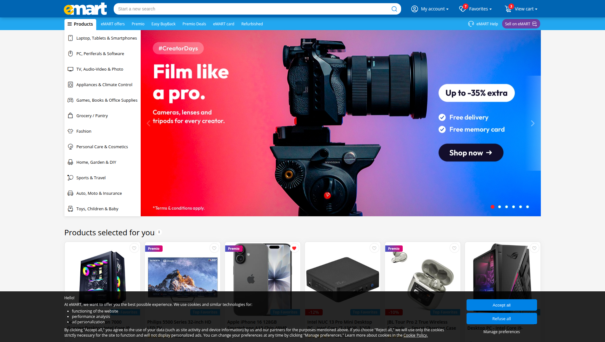
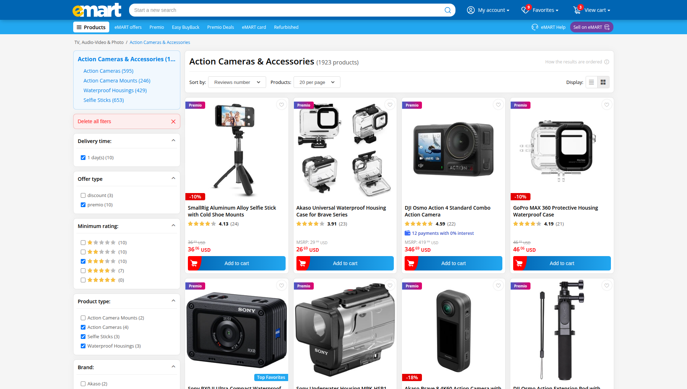
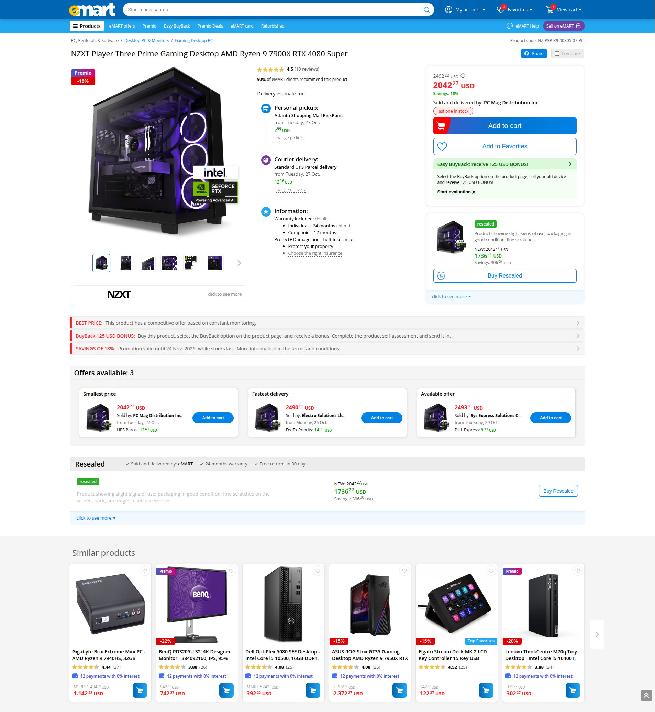
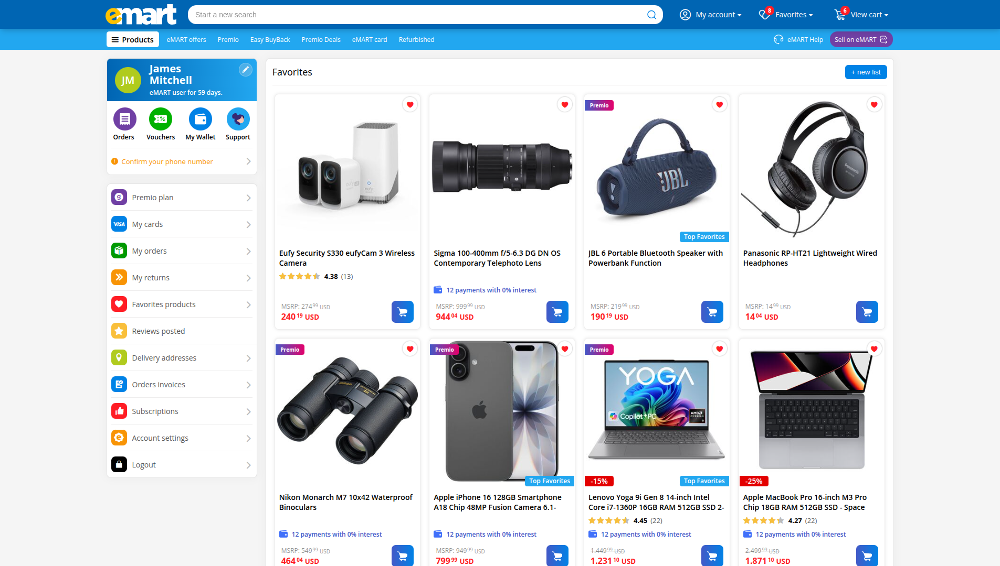
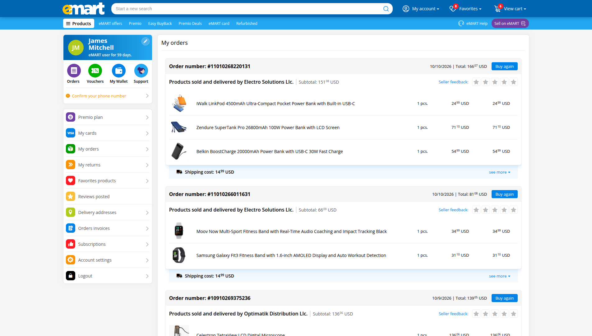
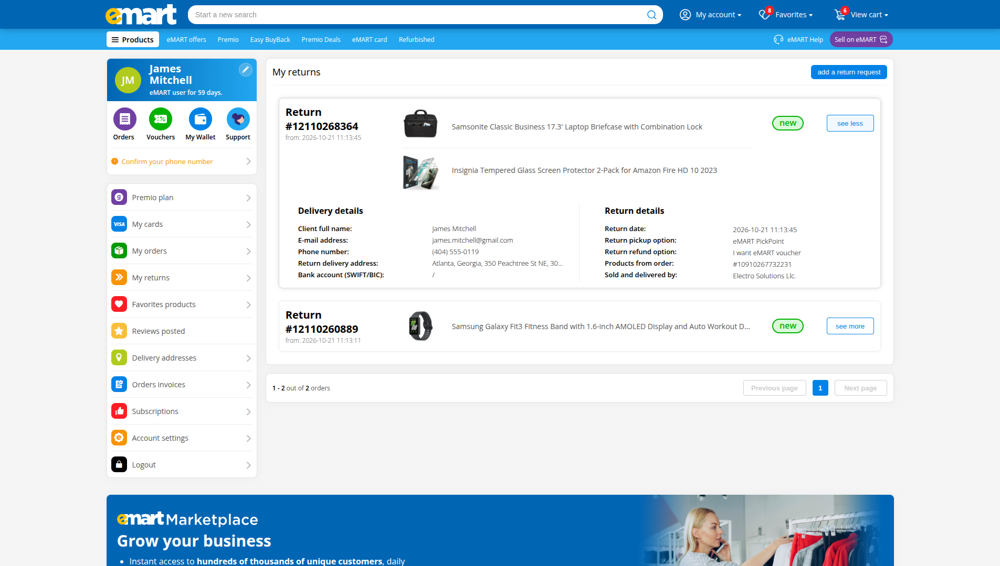
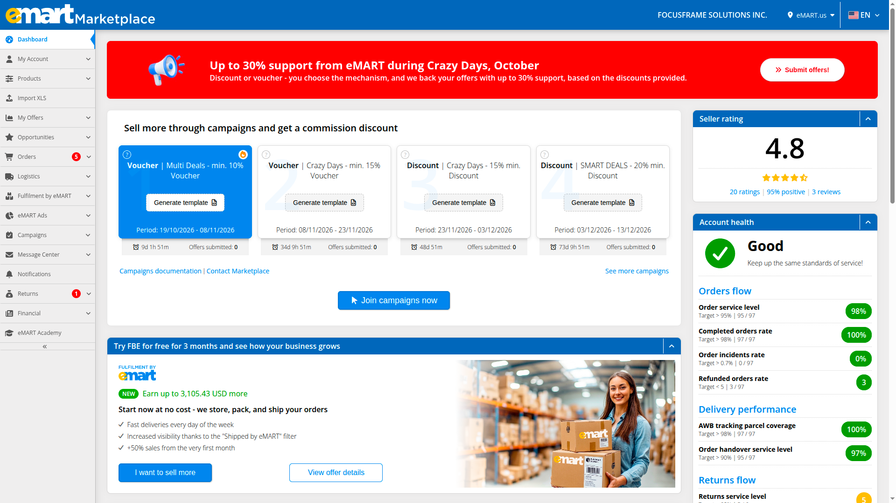
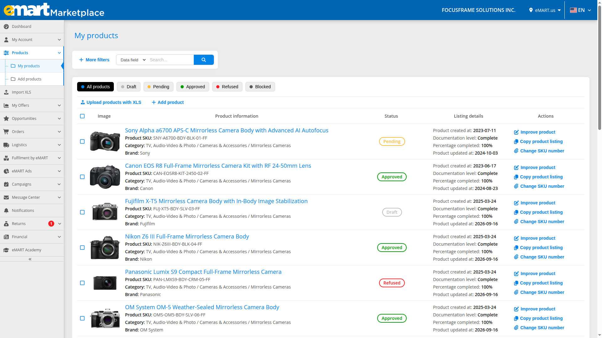
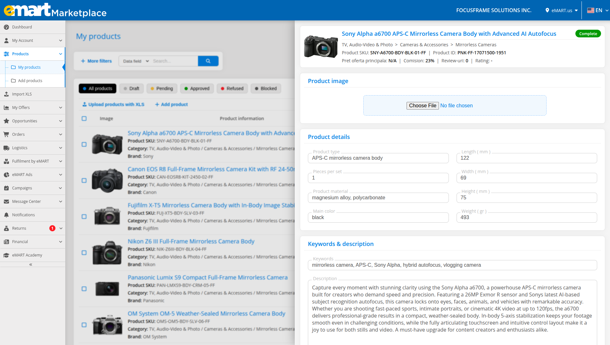
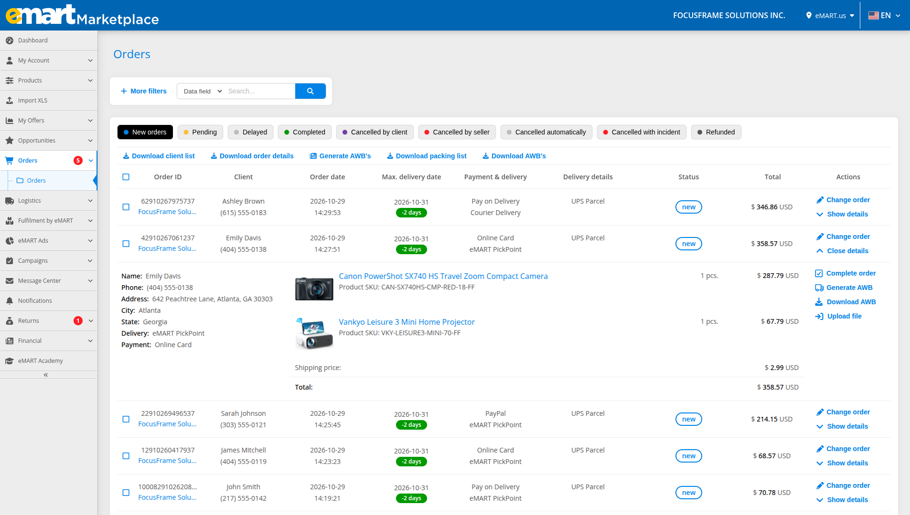

# eMART Multi Vendor Marketplace

Laravel multi-vendor marketplace built from scratch in Ubuntu with client and seller areas, custom auth, compounded product filters and with SEO-friendly product page.

**Live demo:** [emart.click](https://emart.click)

## Stack

HTML, SASS, JavaScript, jQuery, AJAX, Laravel, PHP, Blade, MySQL

## Features

- Built solo a marketplace with full CRUD functionalities, 30+ Blade pages, separate client and seller areas, and custom authentication, inspired by eMAG’s UI/UX and developed on Ubuntu.
- Implemented category pages and reviews sections with compounded filters and live counts, favorites, cart, one-page checkout that splits orders per seller and delivery type and fully dynamic returns flow.
- Built most page content dynamically with jQuery and Ajax over a MySQL back-end, with skeleton loading states; key product content is rendered server-side in Blade for SEO and first paint.
- Optimized images and loading times with lazy loading and eager, high-priority rows above the fold and ImageMagick thumbnails between 5 and 15 kB; 100 SEO and 85-90 Performance in Lighthouse (localhost build).
- Marketplace deployed and served from a Hetzner VM via nginx, behind a Cloudflare Tunnel with HTTPS.

“Note: Seeders and placeholder product assets are not included in the repo.

